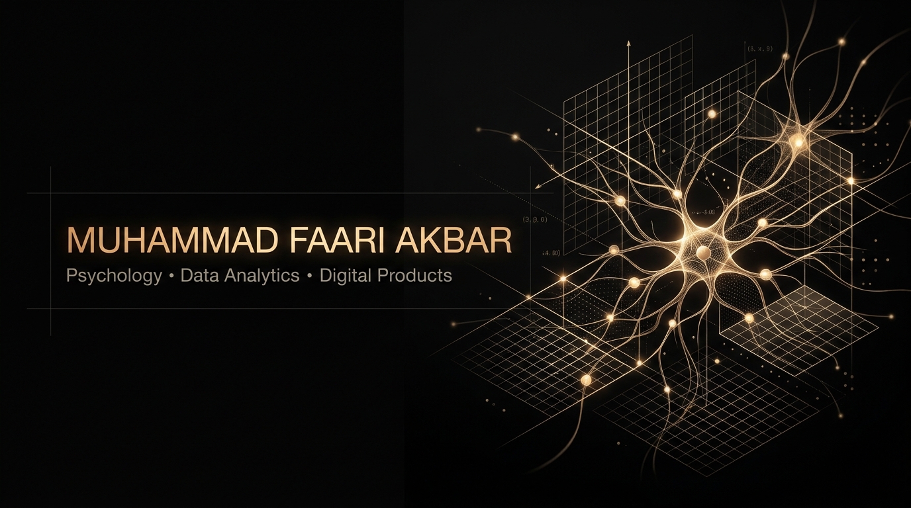

# MUHAMMAD FAARI AKBAR
### Behavioral Psychology &bull; Data Analytics &bull; Digital Product Builder &bull; Game Concept Designer

**[LinkedIn](https://linkedin.com/in/faarimuhammad)** &bull; **[Featured Showcases](#curated-engineering--design-showcases)** &bull; **[Core Competencies](#core-competency-matrix)** &bull; **[Professional Background](#professional-background--philosophy)**

---

## Executive Overview

I operate at the intersection of **human behavioral science**, **quantitative data analytics**, and **modern digital craftsmanship**. Holding a Bachelor of Psychology (S.Psi.) from Universitas Muhammadiyah Prof. Dr. Hamka (UHAMKA) and certified in **Talent Management** and **Data Analysis**, my work bridges organizational understanding with functional software architecture.

Whether architecting statutory-compliant human capital systems, developing cognitive scaffolding software for early childhood education, or designing intricate multi-layered psychological game narratives, my approach emphasizes:
- **Human-Centric Logic:** Designing systems and interfaces that match cognitive workflows and real-world behavior.
- **Evidence-Based Scaffolding:** Applying psychological principles (ZPD, Dual Coding Theory, Self-Determination Theory) to digital learning platforms.
- **Defensive & Modular Engineering:** Clean separation of concerns, zero superfluous dependencies, and production-ready deployments.

---

## Curated Engineering & Design Showcases

### 1. Enterprise HR & Statutory Financial Systems

| Repository | Domain & Architecture | Core Highlights |
|:---|:---|:---|
| **[PayRoll](https://github.com/faarimuhammad2502/PayRoll)** | Human Resources Information System & Statutory Compliance | Fully compliant with Indonesian labor regulations (**PP 58/2023 TER PPh 21**, **PP 35/36 2021**). Features a 3-tier organizational hierarchy, overtime calculation algorithms, and multi-tenant department routing. |
| **[we-saves](https://github.com/faarimuhammad2502/we-saves)** | Dual-Ledger Collaborative FinTech Platform | Shared financial management system designed for partners and couples. Features zero-backend privacy-first `localStorage` persistence, PIN authorization, and multi-wallet reconciliation. |

---

### 2. Cognitive Pedagogy & Language Acquisition Platforms

| Repository | Domain & Architecture | Core Highlights |
|:---|:---|:---|
| **[EnglishSteps-Michelle](https://github.com/faarimuhammad2502/EnglishSteps-Michelle)** | Adaptive Language Learning & Cloud Verification | Comprehensive **CEFR A0–A1** platform featuring a 1,000-word lexical corpus, speech synthesis, **Supabase PostgreSQL** cloud persistence, and a public cryptographic certificate verification portal. *[Live Deployment](https://englishsteps-michelle.vercel.app)* |
| **[web-aplikasi-belajar-omahles](https://github.com/faarimuhammad2502/web-aplikasi-belajar-omahles)** | Early Childhood & Primary EdTech Portal | Multi-tier educational software for Kindergarten and Grades 1–6. Built on Vygotskian ZPD principles with interactive math, literacy modules, and gamified achievement feedback. *[Live Deployment](https://web-aplikasi-omahles.vercel.app)* |
| **[cept](https://github.com/faarimuhammad2502/cept)** | Cambridge CEFR Assessment Engine | Diagnostic English evaluation platform benchmarking learners toward Cambridge B2–C1 standards. Integrates native Web Speech British listening modules and diagnostic scoring matrices. |

---

### 3. Narrative Architecture & Atmospheric Game Concepts

| Repository | Domain & Architecture | Core Highlights |
|:---|:---|:---|
| **[roughtale8](https://github.com/faarimuhammad2502/roughtale8)** | Original Psychological Horror Game Concept | An original 5-character branching narrative set in the 8th and final cycle of world annihilation. Deeply explores cyclical trauma, consequence matrices, psychological horror, and existential acceptance. |
| **[pymobile-calc](https://github.com/faarimuhammad2502/pymobile-calc)** | Cross-Platform Mobile Application (Python / Flet) | Scientific calculator and unit conversion engine built on Python with Google's **Flutter** engine. Implements strict **MVC separation**, notch-safe mobile insets, and zero-latency reactive state updates. |

---

## Core Competency Matrix

### Behavioral Psychology & Human Capital
- **Talent Acquisition & Recruitment:** Competency-based interviewing, candidate persona mapping, behavioral assessments.
- **People & Culture / HR Generalist:** Compensation & benefits structuring, Indonesian statutory compliance (BPJS, PPh 21 TER, PP 35/2021), organizational hierarchy modeling.
- **Learning & Cognitive Development:** Instructional design, educational scaffolding, cognitive mentoring, and developmental psychology.

### Data Analytics & Systems
- **Exploratory Data Analysis (EDA):** Statistical distributions, attrition tracking, performance telemetry, survey evaluation.
- **Tooling & Environments:** Python (Pandas, NumPy), SQL, Google Sheets API / AppSheet, Microsoft Excel Advanced Modeling.

### Digital Craftsmanship & Prototyping
- **Web Applications:** Semantic HTML5, CSS3 Custom Tokens, Modular Vanilla JavaScript (ES2022), Tailwind CSS.
- **Mobile & Cross-Platform:** Python Flet (Flutter rendering engine), Android APK packaging.
- **Cloud & BaaS:** Supabase (PostgreSQL 15, Row-Level Security, Auth), Vercel Global Edge Deployment.

---

## Professional Background & Philosophy

- **Education:** S1 Psikologi, Universitas Muhammadiyah Prof. Dr. Hamka (UHAMKA) Jakarta (2018–2024).
- **Practical Experience:**
  - **Shadow Teacher / Student Mentoring:** SMAIT Buahati Islamic School (July 2025 – Present) &mdash; Behavioral guidance, cognitive adaptation, and personalized pedagogical support.
  - **Business Analyst Intern:** PT Mahabudi (Jan 2024 – Dec 2024) &mdash; Process mapping, data verification, and operational workflow analysis.
- **Certifications:** Talent Management Specialist, Data Analysis Fundamentals.
- **Execution Philosophy:** *Clarity over complexity, execution over endless planning, and human value over superficial decoration.*

---

## Connect & Collaborate

- **LinkedIn:** [linkedin.com/in/faarimuhammad](https://linkedin.com/in/faarimuhammad)
- **GitHub:** [github.com/faarimuhammad2502](https://github.com/faarimuhammad2502)
- **Location:** Jakarta, Indonesia
